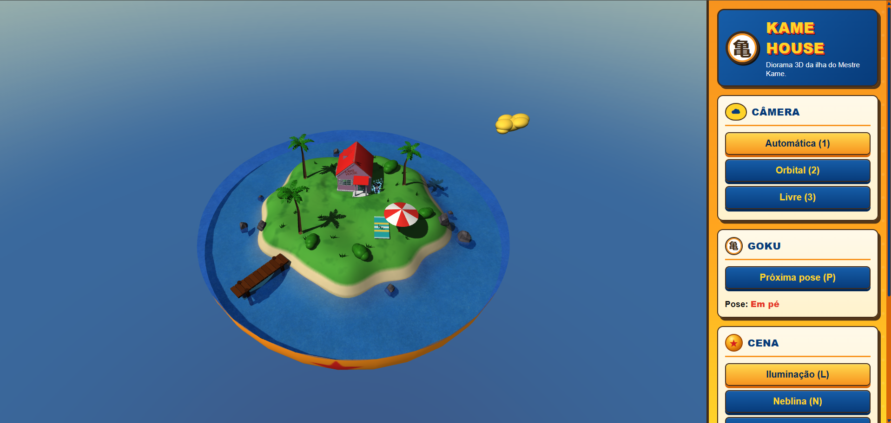
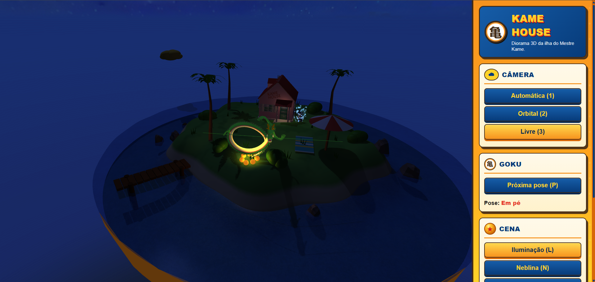
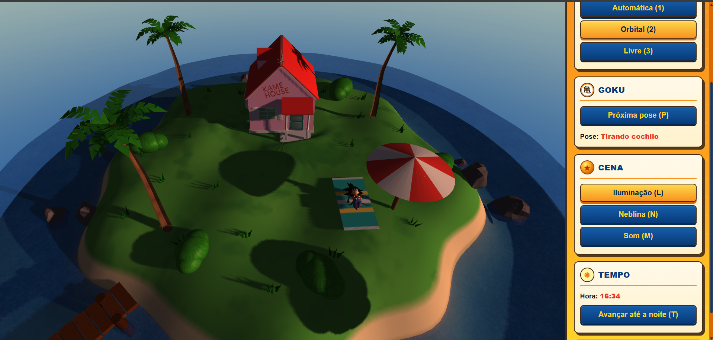

# 🐢 Kame House — Diorama em WebGL

> Trabalho Prático 2 de Computação Gráfica — um paraíso dentro da cápsula: a ilha do Mestre Kame, recriada em WebGL2.

🔗 **Cena publicada:** https://guili-lopes.github.io/TP2-CG---Casa-do-Mestre-Kame-Diorama/

📦 **Repositório:** https://github.com/Guili-Lopes/TP2-CG---Casa-do-Mestre-Kame-Diorama

🎬 **Vídeo:** https://youtu.be/9kyW9sLNBsY?si=H_PrHCeoZjeK77EF

---

## (a) A Cena

Uma pequena ilha tropical cercada por mar, apoiada sobre meia Esfera do Dragão gigante. No alto da ilha fica a **Kame House**, com seu catavento de galo apontando para a direção de onde vem o vento, rodeada de palmeiras, pedras, arbustos e grama que balançam com as rajadas. Na praia há um guarda-sol com canga e um píer de madeira entrando na água. O **Goku** vive na ilha: em pé ao lado da casa, envolto em sua aura de ki; sentado na ponta do píer; ou tirando um cochilo na canga — sempre balançando o rabo. A **nuvem voadora** circula o diorama. O tempo passa, o sol cruza o céu, a lâmpada da varanda acende ao anoitecer e… algo especial acontece quando escurece.

### Controles

| Tecla / Ação | Função |
|---|---|
| <kbd>1</kbd> | Câmera 1: a ~45º, girando em torno da ilha |
| <kbd>2</kbd> | Câmera 2: orbital, controlada pelo mouse |
| <kbd>3</kbd> | Câmera 3: navegação livre |
| <kbd>W</kbd><kbd>A</kbd><kbd>S</kbd><kbd>D</kbd> | Voar com a câmera 3 |
| Arrastar o mouse | Orbitar (câmera 2) ou mudar a direção do olhar (câmera 3) |
| Scroll do mouse | Aproximar/afastar (câmeras 1 e 2) |
| <kbd>P</kbd> | Alterna as poses do Goku (com o som de teletransporte) |
| <kbd>L</kbd> | Liga/desliga a iluminação |
| <kbd>N</kbd> | Liga/desliga a neblina |
| <kbd>T</kbd> | Avança o tempo até a noite (ou até o dia) |
| <kbd>M</kbd> | Liga/desliga o som |

Todos os controles também estão disponíveis como botões na barra lateral, que mostra a câmera ativa, a pose do Goku e a hora do dia.

---

## (b) Criador(es)

**Guilherme Lourenço Lopes** — Engenharia de Computação, UFCI-MG
- 📧 E-mail: guilhermellopes2004@gmail.com
- 💼 LinkedIn: _www.linkedin.com/in/guilherme-lourenço-lopes-692220212_
- 🐙 GitHub: [Guili-Lopes](https://github.com/Guili-Lopes)

---

## (c) Screenshots

| Dia | Noite |
|---|---|
|  |  |

---

## (d) Opcionais

- [x] **1. Neblina**
  > 🌟 Neblina: funcionalidade acrescentada por comando do teclado (N), podendo ser habilitada e desabilitada durante a execução

  _Na cena:_ neblina exponencial ao quadrado calculada por fragmento, com a cor do horizonte, alternada pela tecla <kbd>N</kbd>. A cor acompanha a hora do dia (azulada de dia, alaranjada no pôr do sol, escura à noite), e o céu recebe a mesma névoa numa faixa em volta do horizonte, para os objetos distantes se dissolverem nele.

- [x] **2. Música e efeitos sonoros**
  > 🌟 Música, efeitos sonoros e/ou som ambiente: inclua música de fundo, sons ambiente e efeitos sonoros (este último, caso haja algum tipo de interação)

  _Na cena:_ música de fundo (Cha-La Head-Cha-La em versão forró), som ambiente das ondas do mar, efeito de teletransporte ao trocar a pose do Goku (<kbd>P</kbd>) e o som do Shenlong quando as esferas do dragão são reunidas. A tecla <kbd>M</kbd> liga e desliga todos os sons.

- [x] **3. Skybox**
  > ⭐ Skybox, skyphere ou skydome: se considerarmos que nosso mundo está definido dentro de um cubo (skybox), podemos colocar uma imagem de textura em cada face interna (são 6) que represente o horizonte naquela direção. Veja exemplos de texturas de skyboxes e nossa aula sobre efeitos visuais. Repare que o cubo do skybox acompanha a posição, ou seja, não é possível se aproximar de uma parede, muito menos sair do cubo

  _Na cena:_ dois cubemaps em estilo anime (dia e noite), misturados conforme a hora. O cubo é desenhado com um programa próprio, com a matriz de visualização sem a translação (o céu acompanha a câmera, mas não se aproxima) e na profundidade máxima, atrás de todos os objetos.

- [x] **4. Efeitos de partículas**
  > 🍔 Efeitos de partículas: para simular fenômenos como fogo, fumaça, água etc. Falaremos disso na aula de efeitos visuais

  _Na cena:_ aura de ki azul em volta do Goku quando ele está em pé ao lado da casa. Um emissor controla o nascimento, o tempo de vida e a morte das partículas, desenhadas com `gl.POINTS`, uma textura de sprite e blending aditivo. Ao trocar de pose, a aura se dissipa aos poucos; ao voltar, surge com uma rajada.

- [x] **5. Fontes de luz pontuais**
  > Fontes de luz pontuais: coloque fontes de luz em alguns objetos do cenário (eg, luz no poste ou uma poça de gosma radioativa)

  _Na cena:_ a lâmpada da varanda (modelada como filha da casa na hierarquia), que acende ao anoitecer, e as 7 esferas do dragão brilhando à noite. Até 8 luzes pontuais com atenuação são somadas no modelo de Phong.

- [x] **6. Poses alternativas**
  > Poses alternativas: ao alternar as poses do personagem com P, além de mudar a posição e orientação, coloque-o de fato em outra pose (eg, sentado, deitado, dormindo)

  _Na cena:_ Goku em pé ao lado da casa, sentado na ponta do píer com as pernas penduradas e deitado tirando um cochilo na canga. As poses foram criadas com o Mixamo e congeladas no Blender, e as três usam a mesma escala.

- [x] **7. Vários tipos de objetos**
  > Vários tipos de objetos: em vez de compor o cenário com apenas 03 tipos de objetos, tenha uns 07 tipos diferentes para dar variedade

  _Na cena:_ casa, palmeira, pedra, arbusto, tufo de grama, guarda-sol com canga e píer — além da nuvem voadora, da lâmpada da varanda, das esferas do dragão e do Shenlong.

- [x] **8. Ciclo dia/noite**
  > 🍔 Ciclo dia/noite: faça o tempo passar e que isso defina na forma como o cenário é renderizado. Isso pode ser feito configurando-se a fonte de luz direcional com cores diferentes, dependendo da hora do dia
  >
  > Se tiver um skybox, você deve alterá-lo para refletir os horários diferentes

  _Na cena:_ o sol nasce, cruza o céu e se põe, e à noite a luz direcional passa a ser a lua. As cores da luz, da luz ambiente e da neblina são interpoladas por quadros-chave ao longo do dia; o skybox transita entre dia e noite; as sombras giram com o sol; e a lâmpada da varanda acende. A tecla <kbd>T</kbd> acelera o tempo até o próximo período, atravessando a meia-noite.

- [x] **9. Material transparente**
  > Material transparente: tenha algo como vidro ou outra coisa que seja semitransparente. Detalhe: objetos transparentes devem ser desenhados por último. Se fizer o opcional "Líquido", aí este não conta 2x

  _Na cena:_ os vidros das janelas da Kame House (objeto distinto da água), com a transparência como propriedade do material. São desenhados depois dos opacos e da água, não projetam sombra (a luz do sol entra pelas janelas) e mostram o interior da casa, desenhada com as duas faces e a normal invertida no verso.

- [x] **10. Chão com relevo**
  > Chão com relevo: em vez de plano, faça com que o chão tenha relevo. Uma ideia é usar um height-map: uma textura em escala de cinza em que cada texel representa a altura do chão naquele pixel. Veja um exemplo de height map na aula sobre texturas

  _Na cena:_ o height map forma a própria ilha: a terra emerge no centro e afunda sob o mar nas bordas. As alturas são lidas com interpolação bilinear, as normais são recalculadas pela média das normais das faces vizinhas e todos os objetos são apoiados no relevo.

- [x] **11. Câmera de navegação livre**
  > ⭐ Câmera de navegação livre com WASD para voar e mouse para mudar direção

  _Na cena:_ terceira câmera (tecla <kbd>3</kbd>), que herda a posição e a direção da câmera anterior ao ser ativada, com limites de distância e de altura para não sair do diorama nem atravessar o chão.

- [x] **12. Líquido**
  > Líquido: tenha uma região aquática como um lago, poça d'água, mar ou rio. Uma ideia para que um sólido pareça água é que ele (a) tenha certa transparência, (b) tenha uma textura com suas coordenadas animadas e (c-para oceano ou rio agitado) desloque verticalmente os vértices da superfície ao longo do tempo para criar ondas

  _Na cena:_ o mar em volta da ilha, com (a) transparência, (b) duas camadas de textura deslizando em direções diferentes e (c) duas ondas senoidais no vertex shader, com a normal recalculada pela derivada da onda, o reflexo do sol dança sobre a água.

- [x] **13. Vento**
  > ⭐ Vento: simule que existe vento e faça as coisas mexerem com ele. Por exemplo, aplique um shear com uma intensidade dada, em um certo momento, por uma textura que contém ruído branco (eg, perlin noise). Moitas de grama e a copa das árvores podem sofrer essa transformação

  _Na cena:_ shear com intensidade dada por uma textura de ruído que viaja na direção do vento, aplicado à grama, aos arbustos e aos troncos das palmeiras; a copa das palmeiras se inclina em torno do topo do tronco. O vento muda de direção de tempos em tempos, e o galo do catavento vira para apontar a origem dele.

- [x] **14. Modelos tridimensionais**
  > ⭐ Modelos tridimensionais: em vez de usar os sólidos próprios ou da TWGL.js, crie ou use modelos tridimensionais de terceiros e carregue-os no seu programa. Um formato simples é o .obj (mas ele não suporta animação). Tem também o formato glTF (mais complexo mas suporta animação)

  _Na cena:_ Kame House, Goku (nas três poses), palmeiras, pedras e Shenlong, carregados por um leitor de `.obj` próprio que triangula as faces, calcula as normais que faltam e separa as malhas por material.

- [x] **15. Sombras**
  > 💣 Sombras: faça objetos projetarem sombras de acordo com a(s) fonte(s) de luz da cena

  _Na cena:_ shadow mapping com a luz direcional (sol de dia, lua à noite), renderizado em duas passadas: o mapa de profundidade num FBO, visto pela luz com projeção ortográfica, e o teste no fragment shader com bias e PCF 3×3. Os objetos, o relevo da ilha e a nuvem voadora projetam sombras, que giram ao longo do dia.

---

## (e) Créditos

### Modelos 3D

- **"Kame_house"** ([https://skfb.ly/pMPqp](https://skfb.ly/pMPqp)) by mich95 is licensed under [Creative Commons Attribution](http://creativecommons.org/licenses/by/4.0/). _Modificado: convertido para .obj, galo do catavento separado e malha simplificada._
- **"Dragon Ball Kid Goku"** ([https://sketchfab.com/3d-models/dragon-ball-kid-goku-06eb27eb5a5e463997c80f4d26d0ad73](https://sketchfab.com/3d-models/dragon-ball-kid-goku-06eb27eb5a5e463997c80f4d26d0ad73)) by Tigerar1 (@allanromanreyes) — licença Free Standard. _Modificado: normais corrigidas, poses criadas com o Mixamo e rabo separado._
- **"Palmeira Palm Tree"** ([https://skfb.ly/pOwnR](https://skfb.ly/pOwnR)) by Razzart_Games is licensed under [Creative Commons Attribution](http://creativecommons.org/licenses/by/4.0/). _Modificado: convertido para .obj._
- **"Pedras"** ([https://skfb.ly/onAGQ](https://skfb.ly/onAGQ)) by Vitor Balbino is licensed under [Creative Commons Attribution](http://creativecommons.org/licenses/by/4.0/). _Modificado: convertido para .obj e separado em duas pedras._
- **"Shenlong"** ([https://sketchfab.com/3d-models/shenlong-62b61d724aab4761bfd6bea5de92b8ab](https://sketchfab.com/3d-models/shenlong-62b61d724aab4761bfd6bea5de92b8ab)) by yolteotl is licensed under [Creative Commons Attribution](http://creativecommons.org/licenses/by/4.0/). _Modificado: convertido para .obj e materiais renomeados._

### Texturas e imagens

- **Height map da ilha** — gerado com auxílio do ChatGPT (IA).
- **Texturas da ilha, das esferas do dragão, do hemisfério, do guarda-sol, da canga, da madeira, da casca, da folhagem, do ruído e da partícula** — geradas com auxílio do ChatGPT (IA); a textura da ilha foi gerada a partir do height map.
- **Skybox de dia:** "Skybox 05" ([https://freestylized.com/skybox/sky_05/](https://freestylized.com/skybox/sky_05/)) — FreeStylized, licença Royalty Free.
- **Skybox de noite:** "Skybox 87" ([https://freestylized.com/skybox/sky_87/](https://freestylized.com/skybox/sky_87/)) — FreeStylized, licença Royalty Free.
- **Textura da água:** "3 live procedurally generated tiling water textures" ([https://opengameart.org/node/10593](https://opengameart.org/node/10593)) — qubodup, licença [CC0](http://creativecommons.org/publicdomain/zero/1.0/).

### Sons

- **Música:** "Cha-La Head-Cha-La" em versão forró, por **Miguelito Sousa**; composição original de Chiho Kiyooka (música) e Yukinojo Mori (letra).
- **Ondas do mar:** "Ocean Waves" ([https://pixabay.com/pt/sound-effects/natureza-ocean-waves-562776/](https://pixabay.com/pt/sound-effects/natureza-ocean-waves-562776/)) — Pixabay, Licença de Conteúdo Pixabay.
- **Teletransporte do Goku:** "Goku Teleport Sound" ([https://www.myinstants.com/pt/instant/goku-teleport-sound-40972/](https://www.myinstants.com/pt/instant/goku-teleport-sound-40972/)) — Myinstants; áudio original de Dragon Ball.
- **Shenlong:** "Dragon Ball Summoning Shenron Sound Effect" ([https://www.voicy.network/pt/sounds/Pfjpa01x1ES9lrGxcuYzPw-dragon-ball-summining-shenron-sound-effect](https://www.voicy.network/pt/sounds/Pfjpa01x1ES9lrGxcuYzPw-dragon-ball-summining-shenron-sound-effect)) — Voicy; áudio original de Dragon Ball.

### Código e ferramentas

- [TWGL.js](https://twgljs.org/), de Gregg Tavares — licença MIT.
- Utilitários `src/utils/shaders.js` e `src/utils/errors.js` baseados no exemplo [utf-cg-solar-system](https://github.com/fegemo/utf-cg-solar-system), do prof. Flávio Coutinho.
- [Blender](https://www.blender.org/) — conversão, separação e simplificação dos modelos.
- [Mixamo](https://www.mixamo.com/) — rig automático e poses do Goku.

---

_Dragon Ball e seus personagens pertencem a Akira Toriyama, Shueisha e Toei Animation. Este é um trabalho acadêmico, sem fins comerciais._
